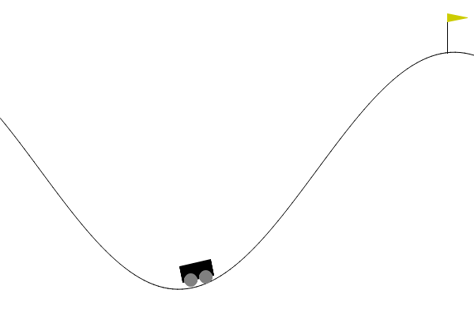

# 🏁 Competencia RL — DQN sobre `MountainCar-v0`

<p align="center">
  
</p>

## 🏁 Día D: 7 Grandes Premios, una hora

Llegó la ronda final. Las pistas cambiaron: hay **7 circuitos**, varios nuevos y otros
con rangos más amplios, y **seeds nuevas que nadie vio**.

- Tienen **una hora** para subir autos. Al final de la hora se cortan los PRs: cuenta el
  último push de cada PR **antes del corte**.
- La **misma policy** corre en los 7 circuitos. En cada uno se reparten puntos estilo F1
  y gana quien sume más.
- Sigue valiendo **un auto titular por escudería**: suma el mejor; el resto queda de reserva.
- No hace falta re-exportar nada: el contrato del `policy.onnx` no cambia.

👉 **Las pistas nuevas están en [El campeonato: 7 circuitos](#-el-campeonato-7-circuitos).**

> **Damas y caballeros, arranca la temporada.** Esto no es la Fórmula 1, pero el
> espíritu es el mismo: cada escudería —su equipo— lleva su propio monoplaza a la
> pista. Solo que acá el monoplaza es una **red Q entrenada** y el circuito es la
> ladera de `MountainCar-v0`. El motor sin potencia no alcanza para subir de frente:
> hay que tomar impulso, leer el momento justo y dejar que la política haga el resto.
>
> No gana quien tiene el auto más rápido, sino quien **llega a la cima en menos pasos**
> y de forma **consistente vuelta tras vuelta** (seed tras seed). Los tiempos se miden
> contra seeds que nadie vio, el cronómetro no miente y el **podio se arma solo** en el
> [leaderboard](LEADERBOARD.md). 🏆

Entrenan su DQN localmente y suben **solo los pesos** como un archivo ONNX.
El board se actualiza solo a medida que mergeamos submissions, y el día de la
competencia corre la ronda final sobre seeds que nadie vio.

## 🚫 Descalificaciones (en revisión)

La escudería **Joacocade** (McQueen-Kachow) queda **descalificada preventivamente** hasta
que revisemos su código de entrenamiento.

Su policy coincide casi exactamente con una solución por **programación dinámica**.
En 300 episodios de prueba, en los estados donde hay una acción claramente mejor, se aparta
de la acción óptima menos de 10 veces; los mejores DQN del resto, entre 100 y 1.000 veces.
Además, su red no es una red Q: tiene una cabeza que predice los pasos exactos que faltan
para llegar y parches puestos justo donde la red se apartaba de la solución óptima.
La competencia es de **DQN**: el auto tiene que aprender de las recompensas del entorno,
no copiar una solución calculada con el modelo.

Sus autos siguen apareciendo en el [leaderboard](LEADERBOARD.md), fuera de concurso: no
suman ni le sacan puestos a nadie. Si el código muestra que es un DQN entrenado con
recompensas, se reincorpora con todos sus puntos.

**athinasalimm (sally-m) fue reincorporada** después de revisar su código: entrenó sus
propios DQN y los refinó con correcciones locales aprendidas de sus propios retornos
(probando las tres acciones y siguiendo con su política). No usó ninguna solución externa.

## Fechas

| | |
|---|---|
| Apertura de submissions | Abierta |
| Última submission (cierre) | **Viernes 6/11** — después de esta fecha no se mergean más PRs |
| Ronda final (día D) | **Viernes 6/11**: una hora con 7 circuitos nuevos y seeds nuevas |

## Regla de oro

> **Solo se suben pesos. Si el PR contiene CÓDIGO, queda descalificado automáticamente.**

El PR puede tocar **únicamente** estos archivos, y solo dentro de la carpeta de tu equipo:

- `submissions/<tu-equipo>/policy.onnx`  — obligatorio
- `submissions/<tu-equipo>/metadata.json` — opcional (nombre del equipo, integrantes)

Cualquier `.py`, `.ipynb`, `.sh`, notebook, o archivo fuera de esa carpeta hace fallar la validación.

**Nombre de la carpeta (`<tu-equipo>`):** solo letras sin tildes, números, `-` y `_`
(nada de espacios, `ñ` ni tildes). Ese nombre es el que aparece en el leaderboard.
Cada carpeta es **un auto**: para mejorar ese auto, subí la versión nueva en la misma
carpeta. No toques carpetas de otros equipos.

`metadata.json` (opcional) tiene este formato:

```json
{"team": "mi-equipo", "members": ["Nombre Apellido", "Nombre Apellido"], "notes": "DQN + target network"}
```

## Contrato del `policy.onnx`

Tu red Q tiene que exportarse exactamente así:

| | nombre | shape | dtype |
|---|---|---|---|
| entrada | `observation` | `[batch, 2]` | float32 |
| salida | `q_values` | `[batch, 3]` | float32 |

- La observación es `[posición, velocidad]`; las 3 acciones son empujar izquierda / nada / derecha.
- Opset **17**, solo operadores estándar de ONNX (sin dominios custom).
- La salida son los **Q-values** de las 3 acciones (no apliques argmax: lo hace el evaluador).
- **Un solo archivo:** los pesos tienen que estar dentro del `policy.onnx`. Las versiones
  nuevas de PyTorch los exportan aparte, en un `policy.onnx.data`; ese archivo no se sube
  y el validador rechaza un `.onnx` que dependa de él. El script de ejemplo ya lo resuelve.
- La política de evaluación es greedy: `acción = argmax(q_values)`.

En `submissions/_ejemplo/export_example.py` tenés cómo exportar desde PyTorch
(ese archivo es solo guía local; **no** lo suban al repo).

## 🏁 El campeonato: 7 circuitos

La pista estándar ya está resuelta: los de arriba están todos en el óptimo, a
centésimas de paso entre sí. Así que esto es un **campeonato**: la **misma policy**
corre en 7 circuitos, que son variantes de MountainCar, y en cada uno se reparten
puntos como en la F1.

| Circuito | Qué cambia |
|---|---|
| **GP Estándar** | Nada: `MountainCar-v0` tal cual. |
| **GP Largada libre** | Largan desde cualquier punto de la pista (posición entre -1.2 y 0.4) y con velocidad inicial (entre -0.05 y 0.05). |
| **GP Largada extrema** 🆕 | Largan desde cualquier punto, hasta pegados a la meta (posición entre -1.2 y 0.5), y con hasta la velocidad máxima para cualquier lado (entre -0.07 y 0.07). |
| **GP Lluvia fuerte** 🆕 | El doble de ruido en los sensores: σ entre 0.03 y 0.06 en la posición y entre 0.003 y 0.006 en la velocidad. |
| **GP Motor débil XL** 🆕 | El motor rinde entre un 5% y un 15% menos (`force` entre 0.00085 y 0.00095, en vez de 0.001). |
| **GP Otra pista XL** 🆕 | La montaña cambia de forma: `cos(f·x)` con `f` entre 2.5 y 2.9 (en vez de 3). |
| **GP Pista empinada** 🆕 | Más gravedad: entre un 4% y un 12% más (`gravity` entre 0.0026 y 0.0028, en vez de 0.0025). |

- Los valores exactos se sortean **en cada episodio** dentro de esos rangos. Su red
  ve solo `[posición, velocidad]`: no sabe en qué circuito está ni qué valores le
  tocaron. Tiene que andar bien en todos.
- **Puntos por posición en cada circuito:** 25, 18, 15, 12, 10, 8, 6, 4, 2, 1 (del 1°
  al 10°). Gana el campeonato quien sume más. Desempate: más primeros puestos,
  después más segundos, etc.
- **Un auto titular por escudería.** La escudería es la **cuenta de GitHub** que abrió el
  PR. Si tienen varios autos, el bot elige como titular el que más puntos suma contra los
  titulares de las demás escuderías. Solo el titular suma y ocupa posiciones; el resto
  aparece en la tabla de **reserva** (con los puntos que haría si fuera el titular), pero no
  le saca puestos a nadie. Tener más autos no da más puntos.
- Cada circuito tiene su propia tabla en el [leaderboard](LEADERBOARD.md), con la
  media, el IQM y el % de episodios en que **no llegaron a la meta**.
- Pista para entrenar: lo que se aprende en una sola versión del entorno no
  generaliza. Busquen **domain randomization**.

Los parámetros exactos de cada circuito están en `config.yaml` (`circuits`) y la
física en `harness/circuits.py`.

## Cómo evalúa

- Una corrida por seed en cada circuito; con política y entorno deterministas, **más seeds = más muestras**.
- En MountainCar la recompensa es **-1 por paso** (máximo -200 si nunca llega a la meta).
  Por eso los retornos son **negativos**: cuanto **más cerca de 0**, mejor.
  Una policy sin entrenar marca -200 fijo.
- En cada circuito se ordena por la **media** de los retornos (con intervalo de confianza
  al 95% por bootstrap). Se reporta también el **IQM** (interquartile mean, robusto a
  outliers) como dato informativo.
- Hay dos conjuntos de seeds: las **públicas** (`seeds/public_seeds.txt`) para que
  prueben, y un set **oculto** para el ranking real. Las seeds ocultas **se rotan**
  durante la competencia, y el día D se usa un set de holdout que nadie vio.

## Antes de empezar: forkeá el repo

No hace falta pedir acceso: cada uno trabaja en **su propio fork** y manda un PR.

1. En GitHub, tocá **Fork** (arriba a la derecha) para crear tu copia del repo.
2. Cloná **tu fork** y agregá este repo como `upstream`, para poder traer cambios:
   ```bash
   git clone https://github.com/<tu-usuario>/competenciaRL.git
   cd competenciaRL
   git remote add upstream https://github.com/nicoRomeroCuruchet/competenciaRL.git
   ```

## Probá localmente antes de subir

El bot evalúa con Python 3.12 y las versiones exactas de `harness/requirements.txt`.
Instalá lo mismo para que tu score local coincida con el del board:

```bash
python3.12 -m venv venv && source venv/bin/activate
pip install -r harness/requirements.txt
pip install torch          # solo para exportar; el evaluador no lo usa
```

1. **Exportá** tu red con `submissions/_ejemplo/export_example.py`: copialo fuera del
   repo, cargá tus pesos donde lo indica el comentario y corrélo. Te deja un
   `policy.onnx` en el directorio donde lo corriste.
2. **Validá** el contrato (es lo mismo que corre el bot en el PR):
   ```bash
   python harness/validate_submission.py --onnx ruta/a/policy.onnx
   ```
3. **Evaluá** con las seeds públicas (`seeds/public_seeds.txt`), en los 7 circuitos:
   ```bash
   python harness/evaluate.py --onnx ruta/a/policy.onnx --team mi-equipo --out /tmp/result.json
   ```
   Te imprime, para cada circuito, la media, el IQM, sus intervalos de confianza y el %
   de episodios sin llegar a la meta. El score con las seeds
   ocultas va a ser parecido pero no idéntico. Usá `--out` para no ensuciar `results/`
   del repo (esa carpeta la escribe el bot).

## Cómo subir

```bash
git fetch upstream
git checkout -b submission-mi-equipo upstream/main
mkdir -p submissions/mi-equipo
cp ruta/a/policy.onnx submissions/mi-equipo/policy.onnx
# opcional: submissions/mi-equipo/metadata.json
git add submissions/mi-equipo/
git commit -m "submission: mi-equipo"
git push -u origin submission-mi-equipo
```

1. Entrá a tu fork en GitHub y abrí un **Pull Request** de tu rama contra `main` de
   `nicoRomeroCuruchet/competenciaRL` (GitHub te ofrece el botón "Compare & pull request").
2. El bot valida, corre la evaluación con las seeds ocultas y te comenta el **score de
   preview** en el PR (tarda unos minutos).
3. Si la validación falla, el bot te comenta el motivo. Corregí, commiteá y pusheá a la
   misma rama de tu fork: el PR se actualiza y el bot vuelve a correr solo.
4. Cuando se mergea a `main`, se actualiza el [leaderboard](LEADERBOARD.md).

Un PR = un auto: si toca más de una carpeta de `submissions/`, se rechaza.

- **Versión nueva de un auto:** subila en la **misma carpeta**; cuenta la última.
- **Varios autos por escudería:** se permiten (un PR por auto), pero solo suma el
  titular. Ver [El campeonato](#-el-campeonato-5-circuitos).

Para cada PR nuevo, creá otra rama desde `upstream/main` actualizado (los dos primeros
comandos de arriba).

## Errores comunes

| Síntoma | Causa y solución |
|---|---|
| "Los pesos están en un archivo externo" | Exportaste con torch nuevo sin el script de ejemplo y quedó un `policy.onnx.data`. Re-exportá con `export_example.py`. |
| "El PR toca archivos fuera de submissions/<equipo>/" | Commiteaste algo más (un notebook, un `.pt`, el `export_example.py`, `results/`…). Sacalo del PR: `git rm --cached <archivo>`, commit y push. |
| "La entrada debe llamarse 'observation'" (o la salida `q_values`) | Faltan `input_names` / `output_names` en el `torch.onnx.export`. |
| Media de **-200** exacta | La policy nunca llega a la meta: suele ser una red sin entrenar o que no cargaste tus pesos antes de exportar. |
| El PR no tiene comentario del bot | Esperá unos minutos y mirá la pestaña **Checks** del PR. Si sigue sin aparecer, avisale al profe. |
